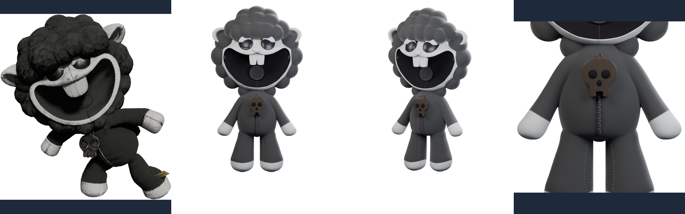
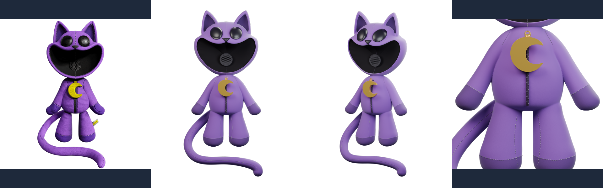
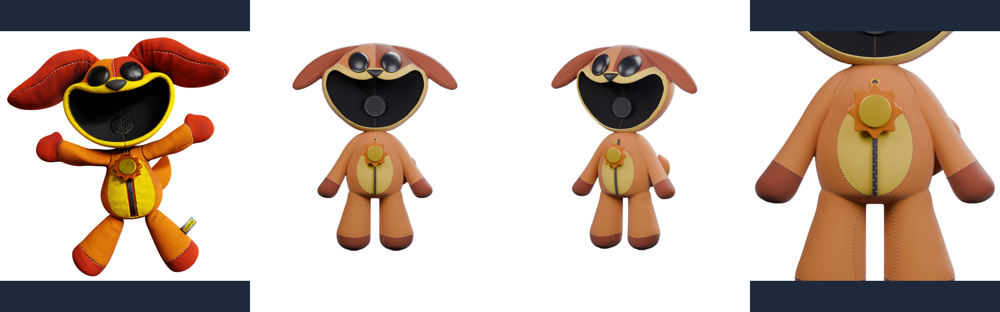
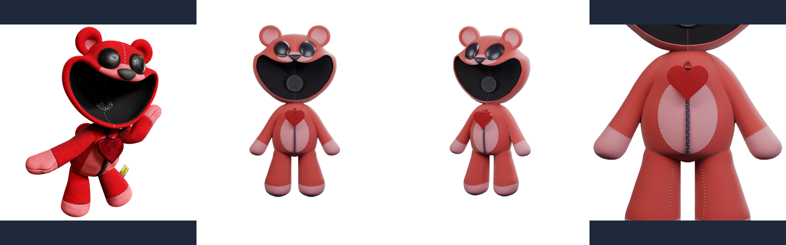
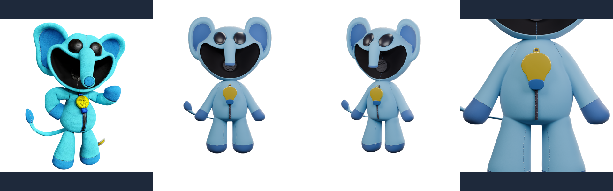
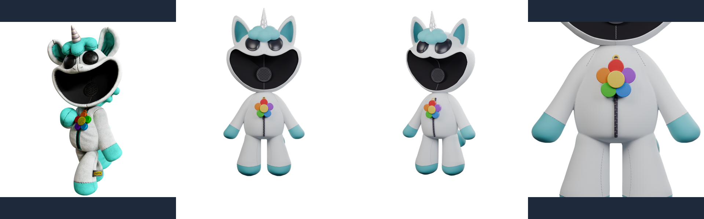
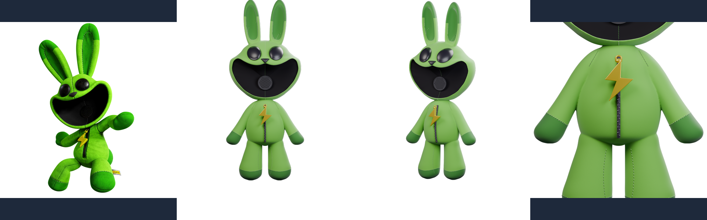
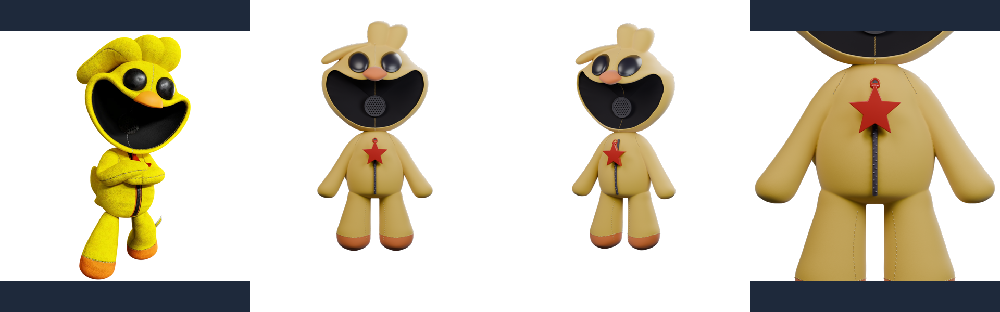
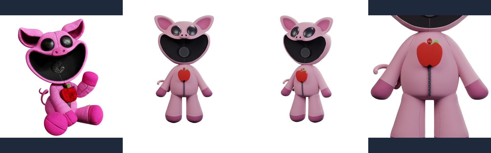

# 🧸🎨 Blender 4.3 3D Plush Base Models (`models/` — All 8 Smiling Critters + Baba Chops)

Native **Blender 4.3 (`bpy` / `bmesh`)** skeletal-rigged subdivision-surface 3D plush base models, **Cycles Path-Traced** studio portraits & 4-panel turnaround sheets, **glTF 2.0 (`.glb`)** / **Wavefront (`.obj`)** exports, and **Three.js WebGL** procedural rigs for **all 8 Smiling Critters** plus **Baba Chops** (`9` characters total).

Every character model features:
- **25 Deform Bones**: `Root`, `Pelvis`, `Spine`, `Chest`, `Neck`, `Head`, `Jaw`, `Eyelid.L`, `Eyelid.R`, `Ear.L`, `Ear.R`, `SkullPendant` (character-specific collar pendant), `Shoulder.L`, `Arm.L`, `HandHoof.L`, `Shoulder.R`, `Arm.R`, `HandHoof.R`, `Leg.L`, `FootHoof.L`, `Leg.R`, `FootHoof.R`, `FartCloud.1`, `FartCloud.2`, `FartCloud.3`.
- **6 Baked NLA Animation Tracks**: `Idle_Breathe`, `Walk_Cycle`, `Happy_Bounce`, `Wave_Hoof`, `Curious_Head_Tilt`, and the 36-frame `<Character>_Fart_Blast` comedy animation.
- **Interactive WebGL 3D Studio (`../<slug>-3d.html`)**: Real-time 60fps Three.js viewport with OrbitControls, camera presets, wireframe/clay modes, joint sliders, and WebAudio synthesized Fart Blast + Giggle SFX.

## 📦 Complete 9-Character 3D Base Model Matrix

| # | Character | Pendant / Signature | Interactive 3D Studio | `.BLEND` (Master) | `.GLB` (glTF 2.0) | `.OBJ` + `.MTL` | Blender `.PY` & Three.js `.JS` | Cycles Render & Turnaround |
| :-: | :--- | :--- | :---: | :---: | :---: | :---: | :---: | :---: |
| `1` | **🐑💀 Baba Chops** *(Black Sheep)* | White Skull Pendant | [**Launch 3D Studio**](../baba-chops-3d.html) | [`baba_chops_plush_base_model.blend`](baba_chops_plush_base_model.blend) *(2.09 MB)* | [`baba_chops_plush_base_model.glb`](baba_chops_plush_base_model.glb) *(3.57 MB)* | [`.obj`](baba_chops_plush_base_model.obj) (27.74 MB) · [`.mtl`](baba_chops_plush_base_model.mtl) | [`build_baba_chops_blender.py`](build_baba_chops_blender.py) · [`baba_chops_model.js`](baba_chops_model.js) | [Hero PNG](baba_chops_blender_cycles_render.png) · [4-Panel Sheet](baba_chops_3d_preview.png) |
| `2` | **🐱🌙 CatNap** *(Purple Cat)* | Gold Crescent Moon Pendant | [**Launch 3D Studio**](../catnap-3d.html) | [`catnap_plush_base_model.blend`](catnap_plush_base_model.blend) *(1.04 MB)* | [`catnap_plush_base_model.glb`](catnap_plush_base_model.glb) *(1.75 MB)* | [`.obj`](catnap_plush_base_model.obj) (2.92 MB) · [`.mtl`](catnap_plush_base_model.mtl) | [`build_catnap_blender.py`](build_catnap_blender.py) · [`catnap_model.js`](catnap_model.js) | [Hero PNG](catnap_blender_cycles_render.png) · [4-Panel Sheet](catnap_3d_preview.png) |
| `3` | **🐶☀️ DogDay** *(Orange-Gold Spaniel Dog)* | Gold Sun Pendant with Orange Center | [**Launch 3D Studio**](../dogday-3d.html) | [`dogday_plush_base_model.blend`](dogday_plush_base_model.blend) *(510 KB)* | [`dogday_plush_base_model.glb`](dogday_plush_base_model.glb) *(816 KB)* | [`.obj`](dogday_plush_base_model.obj) (4.78 MB) · [`.mtl`](dogday_plush_base_model.mtl) | [`build_dogday_blender.py`](build_dogday_blender.py) · [`dogday_model.js`](dogday_model.js) | [Hero PNG](dogday_blender_cycles_render.png) · [4-Panel Sheet](dogday_3d_preview.png) |
| `4` | **🐻❤️ Bobby BearHug** *(Rose-Red Bear)* | Red Heart Pendant | [**Launch 3D Studio**](../bobby-bearhug-3d.html) | [`bobby_bearhug_plush_base_model.blend`](bobby_bearhug_plush_base_model.blend) *(853 KB)* | [`bobby_bearhug_plush_base_model.glb`](bobby_bearhug_plush_base_model.glb) *(1.42 MB)* | [`.obj`](bobby_bearhug_plush_base_model.obj) (2.34 MB) · [`.mtl`](bobby_bearhug_plush_base_model.mtl) | [`build_bobby_bearhug_blender.py`](build_bobby_bearhug_blender.py) · [`bobby_bearhug_model.js`](bobby_bearhug_model.js) | [Hero PNG](bobby_bearhug_blender_cycles_render.png) · [4-Panel Sheet](bobby_bearhug_3d_preview.png) |
| `5` | **🐘💡 Bubba Bubbaphant** *(Sky-Blue Elephant)* | Bright Yellow Lightbulb Pendant | [**Launch 3D Studio**](../bubba-bubbaphant-3d.html) | [`bubba_bubbaphant_plush_base_model.blend`](bubba_bubbaphant_plush_base_model.blend) *(781 KB)* | [`bubba_bubbaphant_plush_base_model.glb`](bubba_bubbaphant_plush_base_model.glb) *(1.29 MB)* | [`.obj`](bubba_bubbaphant_plush_base_model.obj) (4.46 MB) · [`.mtl`](bubba_bubbaphant_plush_base_model.mtl) | [`build_bubba_bubbaphant_blender.py`](build_bubba_bubbaphant_blender.py) · [`bubba_bubbaphant_model.js`](bubba_bubbaphant_model.js) | [Hero PNG](bubba_bubbaphant_blender_cycles_render.png) · [4-Panel Sheet](bubba_bubbaphant_3d_preview.png) |
| `6` | **🦄🌈 CraftyCorn** *(White & Cyan Unicorn)* | Rainbow-Petaled Flower Pendant | [**Launch 3D Studio**](../craftycorn-3d.html) | [`craftycorn_plush_base_model.blend`](craftycorn_plush_base_model.blend) *(923 KB)* | [`craftycorn_plush_base_model.glb`](craftycorn_plush_base_model.glb) *(1.47 MB)* | [`.obj`](craftycorn_plush_base_model.obj) (2.42 MB) · [`.mtl`](craftycorn_plush_base_model.mtl) | [`build_craftycorn_blender.py`](build_craftycorn_blender.py) · [`craftycorn_model.js`](craftycorn_model.js) | [Hero PNG](craftycorn_blender_cycles_render.png) · [4-Panel Sheet](craftycorn_3d_preview.png) |
| `7` | **🐰⚡ Hoppy Hopscotch** *(Mint-Green Rabbit)* | Yellow Lightning Bolt Pendant | [**Launch 3D Studio**](../hoppy-hopscotch-3d.html) | [`hoppy_hopscotch_plush_base_model.blend`](hoppy_hopscotch_plush_base_model.blend) *(883 KB)* | [`hoppy_hopscotch_plush_base_model.glb`](hoppy_hopscotch_plush_base_model.glb) *(1.42 MB)* | [`.obj`](hoppy_hopscotch_plush_base_model.obj) (2.26 MB) · [`.mtl`](hoppy_hopscotch_plush_base_model.mtl) | [`build_hoppy_hopscotch_blender.py`](build_hoppy_hopscotch_blender.py) · [`hoppy_hopscotch_model.js`](hoppy_hopscotch_model.js) | [Hero PNG](hoppy_hopscotch_blender_cycles_render.png) · [4-Panel Sheet](hoppy_hopscotch_3d_preview.png) |
| `8` | **🐓⭐ KickinChicken** *(Golden-Yellow Rooster)* | Gold 5-Pointed Star Pendant | [**Launch 3D Studio**](../kickin-chicken-3d.html) | [`kickin_chicken_plush_base_model.blend`](kickin_chicken_plush_base_model.blend) *(802 KB)* | [`kickin_chicken_plush_base_model.glb`](kickin_chicken_plush_base_model.glb) *(1.33 MB)* | [`.obj`](kickin_chicken_plush_base_model.obj) (2.12 MB) · [`.mtl`](kickin_chicken_plush_base_model.mtl) | [`build_kickin_chicken_blender.py`](build_kickin_chicken_blender.py) · [`kickin_chicken_model.js`](kickin_chicken_model.js) | [Hero PNG](kickin_chicken_blender_cycles_render.png) · [4-Panel Sheet](kickin_chicken_3d_preview.png) |
| `9` | **🐷🍎 PickyPiggy** *(Bubblegum-Pink Pig)* | Red Apple with Green Leaf Pendant | [**Launch 3D Studio**](../picky-piggy-3d.html) | [`picky_piggy_plush_base_model.blend`](picky_piggy_plush_base_model.blend) *(985 KB)* | [`picky_piggy_plush_base_model.glb`](picky_piggy_plush_base_model.glb) *(1.64 MB)* | [`.obj`](picky_piggy_plush_base_model.obj) (2.71 MB) · [`.mtl`](picky_piggy_plush_base_model.mtl) | [`build_picky_piggy_blender.py`](build_picky_piggy_blender.py) · [`picky_piggy_model.js`](picky_piggy_model.js) | [Hero PNG](picky_piggy_blender_cycles_render.png) · [4-Panel Sheet](picky_piggy_3d_preview.png) |

---

## 🖼️ 4-Panel Reference Plush vs. Blender 4.3 Cycles Turnaround Sheets (All 9 Characters)

### 1. 🐑💀 Baba Chops (`baba_chops_plush_base_model`) — White Skull Pendant
- **Reference Plush Image**: [`../images/128_BabaToyRenderNew.webp`](../images/128_BabaToyRenderNew.webp) · **Interactive 3D Studio**: [`../baba-chops-3d.html`](../baba-chops-3d.html) · **Blender Generator**: [`build_baba_chops_blender.py`](build_baba_chops_blender.py)

### 2. 🐱🌙 CatNap (`catnap_plush_base_model`) — Gold Crescent Moon Pendant
- **Reference Plush Image**: [`../images/319_OfficialToyCatNapRender.png`](../images/319_OfficialToyCatNapRender.png) · **Interactive 3D Studio**: [`../catnap-3d.html`](../catnap-3d.html) · **Blender Generator**: [`build_catnap_blender.py`](build_catnap_blender.py)

### 3. 🐶☀️ DogDay (`dogday_plush_base_model`) — Gold Sun Pendant with Orange Center
- **Reference Plush Image**: [`../images/323_OfficialToyDogDayRender.png`](../images/323_OfficialToyDogDayRender.png) · **Interactive 3D Studio**: [`../dogday-3d.html`](../dogday-3d.html) · **Blender Generator**: [`build_dogday_blender.py`](build_dogday_blender.py)

### 4. 🐻❤️ Bobby BearHug (`bobby_bearhug_plush_base_model`) — Red Heart Pendant
- **Reference Plush Image**: [`../images/320_OfficialBobbyRender.png`](../images/320_OfficialBobbyRender.png) · **Interactive 3D Studio**: [`../bobby-bearhug-3d.html`](../bobby-bearhug-3d.html) · **Blender Generator**: [`build_bobby_bearhug_blender.py`](build_bobby_bearhug_blender.py)

### 5. 🐘💡 Bubba Bubbaphant (`bubba_bubbaphant_plush_base_model`) — Bright Yellow Lightbulb Pendant
- **Reference Plush Image**: [`../images/321_OfficialBubbaRender.png`](../images/321_OfficialBubbaRender.png) · **Interactive 3D Studio**: [`../bubba-bubbaphant-3d.html`](../bubba-bubbaphant-3d.html) · **Blender Generator**: [`build_bubba_bubbaphant_blender.py`](build_bubba_bubbaphant_blender.py)

### 6. 🦄🌈 CraftyCorn (`craftycorn_plush_base_model`) — Rainbow-Petaled Flower Pendant
- **Reference Plush Image**: [`../images/322_OfficialCraftyCornRender.png`](../images/322_OfficialCraftyCornRender.png) · **Interactive 3D Studio**: [`../craftycorn-3d.html`](../craftycorn-3d.html) · **Blender Generator**: [`build_craftycorn_blender.py`](build_craftycorn_blender.py)

### 7. 🐰⚡ Hoppy Hopscotch (`hoppy_hopscotch_plush_base_model`) — Yellow Lightning Bolt Pendant
- **Reference Plush Image**: [`../images/324_OfficialHoppyRender.png`](../images/324_OfficialHoppyRender.png) · **Interactive 3D Studio**: [`../hoppy-hopscotch-3d.html`](../hoppy-hopscotch-3d.html) · **Blender Generator**: [`build_hoppy_hopscotch_blender.py`](build_hoppy_hopscotch_blender.py)

### 8. 🐓⭐ KickinChicken (`kickin_chicken_plush_base_model`) — Gold 5-Pointed Star Pendant
- **Reference Plush Image**: [`../images/325_OfficialKickinChickenRender.png`](../images/325_OfficialKickinChickenRender.png) · **Interactive 3D Studio**: [`../kickin-chicken-3d.html`](../kickin-chicken-3d.html) · **Blender Generator**: [`build_kickin_chicken_blender.py`](build_kickin_chicken_blender.py)

### 9. 🐷🍎 PickyPiggy (`picky_piggy_plush_base_model`) — Red Apple with Green Leaf Pendant
- **Reference Plush Image**: [`../images/326_OfficialPickyPiggyRender.png`](../images/326_OfficialPickyPiggyRender.png) · **Interactive 3D Studio**: [`../picky-piggy-3d.html`](../picky-piggy-3d.html) · **Blender Generator**: [`build_picky_piggy_blender.py`](build_picky_piggy_blender.py)

